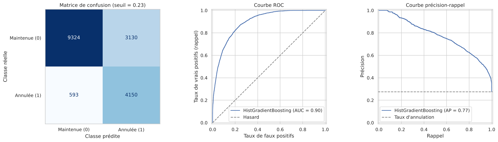
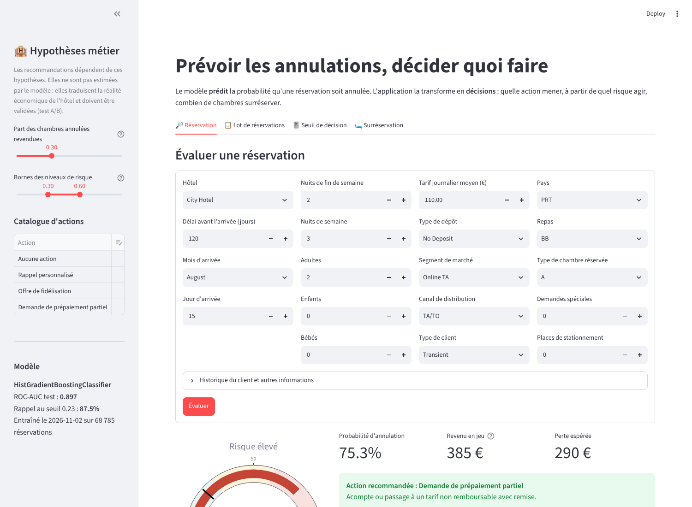
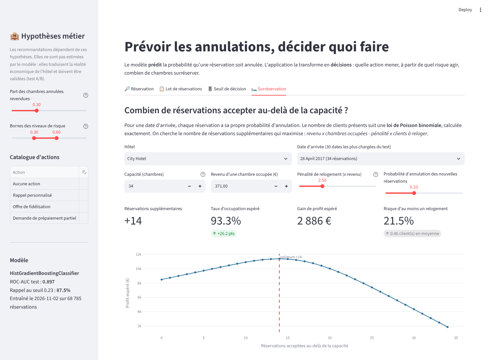

# Prédiction des annulations de réservations hôtelières

Pipeline scikit-learn complet (prétraitement, transformateurs personnalisés, sélection des caractéristiques, classification) pour prédire l'annulation d'une réservation, prolongé par une **application Streamlit d'analyse prescriptive** qui transforme les prédictions en décisions.

> Évaluation sommative 2, *Intelligence artificielle appliquée au prétraitement des données* (030513 IFM), Collège La Cité, automne 2026.
> Auteur : Yacine Lezoul

---

## Résultats clés

| Indicateur (ensemble de test, 17 197 réservations) | Valeur |
|---|---|
| ROC-AUC | **0,897** |
| Rappel des annulations (seuil optimal 0,23) | **87,5 %** |
| Précision au seuil optimal | 57,0 % |
| F1 au seuil optimal | 0,690 |
| Score de Brier (calibration) | 0,114 (référence sans modèle : 0,200) |

Modèle retenu : **HistGradientBoostingClassifier** optimisé par `RandomizedSearchCV`, comparé à une régression logistique et à une forêt aléatoire.



---

## Architecture du pipeline

```
Réservation brute (27 variables)
        │
        ▼
HotelFeatureEngineer ─────────── variables métier : total_nights, total_guests, adr_per_person,
        │                        has_children, has_agent, has_company, arrival_season
        ▼
ColumnTransformer
   ├─ continues   : SimpleImputer(median) → OutlierCapper → StandardScaler
   ├─ discrètes   : SimpleImputer(median) → StandardScaler
   ├─ binaires    : SimpleImputer(most_frequent)
   └─ catégories  : SimpleImputer("Inconnu") → RareCategoryGrouper → OneHotEncoder
        │                                                        (93 colonnes)
        ▼
SelectFromModel(RandomForest, seuil = médiane) ──── 47 colonnes retenues
        │
        ▼
HistGradientBoostingClassifier ─── probabilité d'annulation
        │
        ▼
Analyse prescriptive ─── seuil optimal, action par réservation, surréservation
```

Points méthodologiques :
- **Fuite de données évitée** : `reservation_status`, `reservation_status_date` et `assigned_room_type` sont connues seulement après l'issue de la réservation ; elles sont retirées.
- **Doublons supprimés** (33 241 lignes) pour qu'aucune réservation identique ne figure à la fois dans l'entraînement et le test.
- **Aucune statistique apprise hors pipeline** : imputation, écrêtage, regroupement des modalités et sélection sont réappris sur chaque pli de validation croisée.
- **Probabilités calibrées** (pas de pondération des classes) : le déséquilibre est traité par le choix d'un seuil fondé sur les coûts métier, choisi sur des prédictions hors pli de l'entraînement.

---

## Structure du dépôt

```
hotel-cancellation-pipeline/
├── app/
│   └── app.py                    # application Streamlit prédictive et prescriptive
├── data/
│   ├── raw/                      # hotels.csv (non versionné, téléchargé automatiquement)
│   └── README.md                 # source et description des données
├── models/                       # pipeline entraîné, métadonnées, ensemble de test (non versionnés)
├── notebooks/
│   └── evaluation_sommative_2.ipynb   # exécution des 5 parties, résultats et interprétations
├── reports/
│   └── figures/                  # graphiques exportés par le notebook
├── src/
│   ├── __init__.py
│   ├── config.py                 # chemins, listes de colonnes, paramètres de reproductibilité
│   ├── data_loader.py            # chargement, audit de qualité, nettoyage, séparation 80/20
│   ├── transformers.py           # HotelFeatureEngineer, RareCategoryGrouper, OutlierCapper
│   ├── preprocessing.py          # pipelines par type de variable et ColumnTransformer
│   ├── feature_selection.py      # SelectFromModel, bilan des variables, information mutuelle
│   ├── model.py                  # pipeline complet, comparaison, optimisation, sauvegarde
│   ├── evaluation.py             # métriques, graphiques, importance par permutation
│   ├── prescriptive.py           # seuil optimal, actions recommandées, surréservation
│   └── train.py                  # entraînement en ligne de commande
├── tests/
│   └── test_transformers.py      # tests unitaires (transformateurs et module prescriptif)
├── .gitignore
├── requirements.txt              # versions fixées
└── README.md
```

---

## Installation

Prérequis : Python 3.11 ou plus récent, Git.

```bash
git clone https://github.com/<votre-compte>/hotel-cancellation-pipeline.git
cd hotel-cancellation-pipeline

# Environnement virtuel
python -m venv .venv
# Windows (PowerShell)
.venv\Scripts\Activate.ps1
# macOS / Linux
source .venv/bin/activate

pip install --upgrade pip
pip install -r requirements.txt
```

Le jeu de données est téléchargé automatiquement au premier chargement. Pour l'ajouter à la main, placez `hotels.csv` dans `data/raw/`.

---

## Utilisation

### 1. Notebook (évaluation complète)
```bash
jupyter lab notebooks/evaluation_sommative_2.ipynb
```
Exécuter toutes les cellules (environ 6 minutes). Le notebook enregistre aussi le pipeline final dans `models/` et les graphiques dans `reports/figures/`.

### 2. Entraînement en ligne de commande
```bash
python -m src.train          # avec optimisation des hyperparamètres (environ 4 minutes)
python -m src.train --fast   # paramètres par défaut (environ 30 secondes)
```

### 3. Application Streamlit
```bash
streamlit run app/app.py
```
Nécessite un modèle entraîné (étape 1 ou 2).

| Onglet | Question à laquelle il répond |
|---|---|
| Réservation | Quel est le risque de cette réservation et que faut-il faire ? |
| Lot de réservations | Quelles réservations traiter en priorité ? (import CSV, export des recommandations) |
| Seuil de décision | À partir de quel risque agir, selon le coût de chaque type d'erreur ? |
| Surréservation | Combien de réservations accepter au-delà de la capacité pour une date ? |

Les hypothèses métier (part des chambres revendues, coût, efficacité et désistement de chaque action) se modifient dans la barre latérale.




### 4. Tests
```bash
python -m pytest -q
```

---

## Analyse prescriptive

Le modèle prédit **qui risque d'annuler** ; le module `src/prescriptive.py` dit **quoi faire** :

1. **Seuil de décision optimal** : minimise `faux négatifs x coût d'une annulation non anticipée + faux positifs x coût d'une action inutile`.
2. **Action par réservation** : maximise `p x revenu x efficacité - coût - (1 - p) x revenu x désistement` parmi aucune action, rappel personnalisé, offre de fidélisation et prépaiement partiel.
3. **Surréservation** : le nombre de clients présents suit une loi de Poisson binomiale, calculée exactement ; on retient le nombre de réservations supplémentaires qui maximise `revenu x chambres occupées - pénalité x clients relogés`.

> Le modèle mesure des associations, pas des effets causaux. Les efficacités des actions sont des hypothèses à valider par un test A/B.

---

## Limites

- Deux hôtels portugais, 2015 à 2017 : réentraîner avant toute utilisation ailleurs.
- Séparation aléatoire : une validation temporelle (test sur 2017) serait plus réaliste.
- `required_car_parking_spaces` et `country` pourraient être complétées à l'arrivée du client (fuite partielle possible), à vérifier auprès de l'hôtel.

## Source des données

Antonio, N., de Almeida, A., & Nunes, L. (2019). *Hotel booking demand datasets*. Data in Brief, 22, 41-49. Version TidyTuesday : <https://github.com/rfordatascience/tidytuesday/tree/main/data/2020/2020-02-11>
